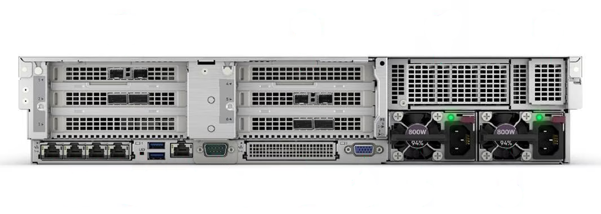

HPE currently certifies only the HPE DL345 Gen11 configuration below for new customer deployments. HPE continues to support existing installations of the legacy platforms listed below on all currently supported SSR releases. Legacy platforms are not available to new customers for purchase or deployment.

## Current Certified Platform

### HPE DL345 Gen11

See the HPE DL345 Gen11 [data sheet](https://www.hpe.com/psnow/doc/PSN1014689145USEN.pdf?jumpid=in_pdp-psnow-dds).

| Property | Certified Configuration |
|---|---|
| Application | Large datacenter, 100G hub. |
| CPU | 64-core AMD EPYC 9575F |
| Memory | 768 GB DDR5 ECC |
| Storage | 2 x 1.92 TB U.3 SSDs in RAID 1. |
| Interfaces | 12 ports total: 4 x 100GbE, 4 x 10/25GbE, and 4 x 1GBase-T. |

#### Bill of Materials
A detailed Bill of Materials (BOM) for the HPE DL345 Gen11 configuration certified for SSR:

| Qty | Product | Description |
|-----|---------|-------------|
| 1 | 5141741348-03 | 1x JNPR Gen11 DL345 with 9575F |
| 1 | P64255-B21 | HPE OEM DL345 Gen11 8SFF CTO Svr |
| 1 | P72758-B21 | AMD EPYC 9575F CPU for HPE |
| 12 | P64986-B21 | HPE 64GB 2Rx4 PC5-6400B-R Smart Kit |
| 1 | P55082-B21 | HPE DL385 Gen11 8SFF TM U.3 x1 BC BP Kit |
| 2 | P64844-B21 | HPE 1.92T NVMeRI SFF BC U.3ST V2 MV SSD |
| 1 | P57117-B21 | HPE DL345 G11 6PCIE Enablement Kit |
| 1 | P47785-B21 | HPE MR216i-p Gen11 SPDM Storage Cntlr |
| 2 | P42044-B21 | MLX MCX631102 10/25GbE 2p SFP28 Adptr |
| 2 | P25960-B21 | MLX MCX623106AS 100GbE 2p QSFP56 Adptr |
| 1 | P08449-B21 | INT I350 1GbE 4p BASE-T OCP3 Adptr |
| 1 | 339778-B21 | HPE Raid 1 Drive 1 FIO Setting |
| 2 | P44712-B21 | HPE 1800W-2200W FS Ti Ht Plg PS Kit |
| 1 | BD505A | HPE iLO Adv 1-svr Lic 3yr Support |
| 1 | P57123-B21 | HPE DL345 G11 8SFF x1 Box2/3 TM Cbl Kit |
| 6 | P58465-B21 | HPE DL3X5 Gen11 2U Perf Fan Kit |
| 1 | P50400-B21 | HPE DL3XX Gen11 2U Com Bezel Kit |
| 1 | P52351-B21 | HPE DL3XX Gen11 Easy Install Rail 2 Kit |
| 1 | P58459-B21 | HPE DL3X5 Gen11 Perf 2U Heat Sink Kit |
| 1 | H40TDE | HPE 5Y TC Bas OEM DL345 Gen11 HW SVC |

## Legacy Platforms for Existing Installations

HPE continues to support existing installations of the following previously certified platforms on all currently supported SSR releases. These platforms are not available to new customers for purchase or deployment.

| Platform | Model Numbers |
|---|---|
| Silicom Madrid | 90500-0151-G02, 90500-0151-G12, 90500-0151-G71, 90500-0151-G03, 90500-0151-G13 |
| Silicom Madrid Ruggedized | 90500-0159-G01, 90500-0159-G11 |
| Lanner NCA-1515A | L-1515A-8C-16E-128M-SSR, L-1515A-8C-16E-128M-C1-SSR1 |
| Lanner NCA-1515B | L-1515B-4C-8E-128M-SSR1, L-1515B-4C-8E-128M-C1-SSR |
| Lenovo SR650v2 | 7Z73VWQ100 |

