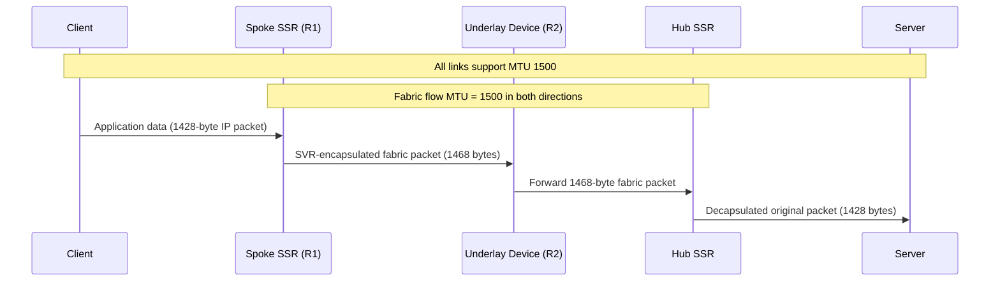
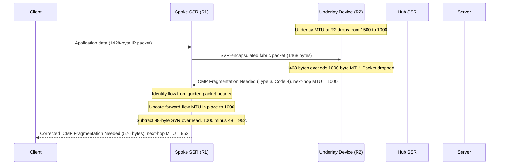
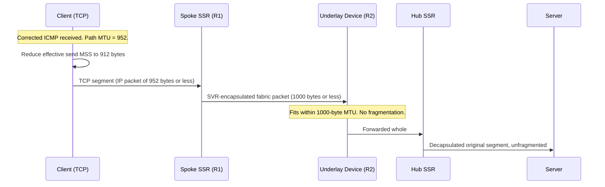
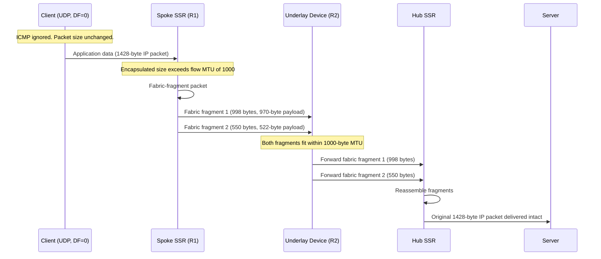

## Periodic Path MTU Discovery

The SSR performs Path MTU Discovery (PMTUD) along the overlay to determine the maximum transmission unit (MTU) for each peer path. Peering SSR routers send packets of various sizes to discover the path MTU. By default, this test runs every ten minutes to account for path changes between peers.

| Direction | Port/Proto | Client Payload (bytes) | Server Payload (bytes) | Default Interval | Notes |
| --- | --- | --- | --- | --- | --- |
| bidirectional | 1280/UDP   | 2945 | 90  | 600s | Interval is configurable within `path-mtu-discovery/interval`, or disabled `path-mtu-discovery/enabled`. |

In deployments where ICMP Destination Unreachable: Fragmentation Needed and DF Set response messages are not generated or are suppressed, the SSR uses probe non-responses to infer the MTU. The SSR treats three consecutive non-responses as equivalent to an ICMP response, which keeps the discovery algorithm moving forward. See [RFC 1191](https://www.rfc-editor.org/rfc/rfc1191) for ICMP-based Path MTU Discovery.

Use `show peers` to view the discovered MTU.

Prior to SSR 7.2.0, a reduced underlay MTU was not discovered until the next PMTUD cycle. Existing sessions continued to use the previous MTU until they were rebuilt, even after periodic PMTUD discovered the change.

Devices in the underlay report an ICMP Destination Unreachable: Fragmentation Needed and DF Set message (Type 3, Code 4) when a packet with DF set exceeds the next-hop MTU. Prior to SSR 7.2.0, the SSR forwarded these messages to the endpoint without acting on the reported MTU. The affected session retained its previous path MTU.

SSR 7.2.0 adds two complementary enhancements under Adaptive Path MTU (I95-60371):

1. **Underlay ICMP Reaction** — The ingress SSR intercepts the ICMP Fragmentation Needed message, updates the affected flow, and generates a corrected ICMP Fragmentation Needed message toward the original sender. The corrected MTU accounts for SVR overhead.
2. **Session Refresh** — The SSR updates the flow that carried the dropped packet in place, using the MTU the underlay reported. The session does not need to be rebuilt.

See [Adaptive Path MTU for Long-Lived Sessions](#adaptive-path-mtu-for-long-lived-sessions) for a hub-and-spoke example.

For TCP flows, configure `enforced-mss automatic` on the egress `network-interface`. This setting, known as MSS clamping, adjusts the advertised TCP maximum segment size (MSS) to reduce fragmentation. See [Configuring `enforced-mss`](#configuring-enforced-mss-recommended-for-tcp).

## Adaptive Path MTU for Long-Lived Sessions

Database replication, backups, and tunnels can maintain sessions across an underlay MTU change. If a route change or additional encapsulation reduces the path MTU, packets sized for the previous MTU no longer fit. Adaptive Path MTU allows the SSR to correct an established flow when the underlay reports the change, without waiting for periodic discovery or a session rebuild.

### Example Topology and Initial State

The following example uses one client-to-server session through a hub-and-spoke overlay:

- **Client** — Sends traffic from the spoke LAN.
- **Spoke SSR R1** — Encapsulates client traffic into SVR at ingress.
- **Underlay Device R2** — Forwards traffic between the spoke and hub.
- **Hub SSR** — Reassembles and decapsulates SVR traffic at egress.
- **Server** — Receives traffic on the hub LAN.

Initially, every hop supports a 1500-byte MTU. Both SSRs use a path MTU of 1500 for the session's fabric flows.



The client sends 1428-byte IP packets. The spoke SSR encapsulates them into SVR. With SVR encapsulation overhead added, the corresponding fabric packet is 1468 bytes, which fits within the initial underlay MTU. R2 forwards it to the hub SSR, which decapsulates it and delivers the original packet to the server.

### The Solution in Short

When the spoke SSR receives an ICMP Fragmentation Needed message from R2, it:

- Updates the affected flow MTU in place, without rebuilding the session.
- Subtracts SVR overhead from the reported MTU and sends a corrected ICMP Fragmentation Needed message to the client.
- Fabric-fragments subsequent oversized packets if the client does not reduce its packet size. The hub SSR reassembles these packets before delivery.

The flow update and client notification provide two ways to handle the reduced MTU: the sender can reduce its packet size, or the SSRs can fragment and reassemble traffic within the fabric.

:::info Introduced In SSR 7.2.0
Adaptive Path MTU applies to overlay (SVR/fabric) sessions between peering SSR routers and requires no configuration. It depends on receiving an ICMP Fragmentation Needed message from the underlay.
:::

| Session State | Behavior |
| --- | --- |
| Existing session | The SSR updates the affected flow in place when it processes an ICMP Fragmentation Needed message. |
| New session | The SSR uses the peer path MTU available at session setup. After periodic PMTUD discovers the reduced MTU, new sessions use that value. A session established before discovery can still require adaptive correction. |

### Detailed Walkthrough

R2's outgoing link MTU toward the hub drops from 1500 to 1000 bytes while the session remains established. The following sequence shows how the spoke SSR processes the next oversized packet and the resulting ICMP response.



#### Step 1: R2 Reports the Reduced MTU

The client continues sending 1428-byte IP packets. The spoke SSR encapsulates the next packet into a 1468-byte fabric packet with DF set. R2 cannot forward it over the 1000-byte link, so it drops the packet.

R2 returns an ICMP Destination Unreachable: Fragmentation Needed and DF Set message (Type 3, Code 4) to the spoke SSR's WAN interface. The message reports a next-hop MTU of 1000 and quotes the dropped packet's IP header.

#### Step 2: The Spoke SSR Updates the Flow

The spoke SSR intercepts the ICMP message and reads the inner, quoted packet header to identify the affected SVR session. It locates the corresponding flow and updates the spoke-to-hub forward-flow MTU to 1000 in place.

The `flow-mtu-updates` counter in `show stats icmp` increments when the flow MTU changes. See [Checking Adaptive Path MTU Activity](#checking-adaptive-path-mtu-activity).

#### Step 3: The Spoke SSR Notifies the Client

The reported MTU applies to encapsulated traffic. The spoke SSR must account for SVR overhead before notifying the client; otherwise, a client packet sized to 1000 bytes would exceed the underlay MTU after encapsulation.

In this example, the SSR subtracts a 48-byte SVR overhead allowance and sends a corrected ICMP Fragmentation Needed message to the client with a next-hop MTU of **952 bytes** (1000 − 48). The wire length of the ICMP packet itself (576 bytes in this example) is separate from the MTU value it reports inside its payload — do not confuse the two.

:::info
The SVR overhead allowance used for MTU calculation is not necessarily a fixed difference between an individual client packet and its resulting fabric packet. Encryption, HMAC, forward error correction (FEC), and BFD tunneling can affect the usable MTU. Rely on the corrected MTU calculated and reported by the SSR rather than estimating from a single observed packet.
:::

### Scenarios: Post-Correction Traffic Handling

After the flow update, packet handling depends on whether the client reduces its packet size.

#### Scenario 1: TCP Traffic — Sender Adjusts MSS

In this scenario, the TCP client processes the corrected ICMP message and lowers its path MTU to 952 bytes. Its effective send MSS becomes 912 bytes: 952 minus 40 bytes for IPv4 and TCP headers, assuming no options. This changes the segment size used for the established connection; it does not renegotiate the MSS option exchanged during connection setup.

The resulting packets fit within the 1000-byte underlay MTU after SVR encapsulation.



No fabric fragmentation or reassembly is required. Configure [`enforced-mss automatic`](#configuring-enforced-mss-recommended-for-tcp) to clamp the advertised MSS during TCP connection setup. MSS clamping does not replace ICMP-based correction when the path MTU drops during an established connection.

#### Scenario 2: UDP or DF=0 Traffic — Fabric Fragmentation Fallback

In this scenario, the UDP client sends with DF=0 and does not act on the corrected ICMP message. It continues sending 1428-byte IP packets. UDP applications can use ICMP feedback, but UDP does not automatically resize datagrams as TCP resizes segments. DF=0 permits IP fragmentation; it does not itself determine whether the sender responds to ICMP.

The spoke SSR fragments the oversized packets within the fabric, and the hub SSR reassembles them:



The 998- and 550-byte fabric fragments both fit within R2's 1000-byte MTU. Their payloads are 970 and 522 bytes, respectively. The hub SSR reassembles them and delivers the original 1428-byte IP packet to the server. The fragmentation remains within the fabric, but adds processing at both SSRs for each oversized packet.

The following table traces the same sequence at the packet level. Steps 1 through 3 establish the baseline flow MTU update and the ICMP notification sent to the client; steps 4 and 5 show the resulting fabric fragmentation once the client keeps sending oversized packets:

| Step | Packet | Size | Notes |
| --- | --- | --- | --- |
| 1 | Client-to-server IP packet (pre-encapsulation) | 1428 bytes total (1388-byte payload) | Sent from the client to the spoke SSR. |
| 2 | SVR-encapsulated fabric packet | 1468 bytes total (1440-byte fabric payload) | Sent by the spoke SSR toward R2. Exceeds R2's new 1000-byte MTU and is dropped. |
| 3 | Corrected ICMP Fragmentation Needed (Type 3, Code 4) | 576 bytes | Sent by the spoke SSR to the client. Reports next-hop MTU 952 after subtracting the 48-byte SVR overhead allowance. |
| 4 | Fabric fragment 1 | 998 bytes total (970-byte payload) | Sent by the spoke SSR for a later 1428-byte client packet. Fits within R2's 1000-byte MTU. |
| 5 | Fabric fragment 2 | 550 bytes total (522-byte payload) | Second fragment of the same packet. R2 forwards both fragments to the hub SSR for reassembly and delivery to the server. |

#### Scenario 3: Asymmetric Paths and Directional Behavior

Adaptive Path MTU updates each direction independently. An ICMP Fragmentation Needed message updates the flow that carried the dropped packet; it does not also change the reverse flow.

After the spoke SSR processes R2's message:

| Direction | Flow MTU After Correction | Why |
| --- | --- | --- |
| Client to server (spoke SSR to hub SSR) | 1000 | The spoke SSR received the ICMP message from R2 and updated this flow. |
| Server to client (hub SSR to spoke SSR) | 1500 (unchanged) | The hub SSR has not received an ICMP message for this flow. |

If server-to-client traffic also crosses a reduced-MTU link, an oversized packet in that direction causes an ICMP response to the hub SSR. The hub SSR updates its flow and sends the corrected ICMP message to the server.

If the reverse path still supports 1500 bytes, its flow MTU remains unchanged. Check both SSRs when troubleshooting asymmetric paths; `flow-mtu-updates` increments on the SSR that processes the ICMP response.

## Fabric Fragmentation and Oversize Packet Behavior

When an encapsulated packet exceeds the overlay path MTU, the SSR fragments it within the fabric, even if the original packet has the Don't Fragment (DF) bit set. The egress peer reassembles the fabric fragments before delivering the original packet.

Fabric fragmentation is separate from fragmentation of the client's IP packet by an underlay router. It allows traffic to use a smaller underlay MTU without exposing fabric fragments to the endpoint. It also adds fragmentation and reassembly work at the SSRs.

:::info
For TCP traffic, use `enforced-mss automatic` on the egress `network-interface` to reduce fragmentation when connections are established. This setting is not enabled by default.
:::

## Configuration

Adaptive Path MTU requires no configuration. You can configure MSS clamping and the periodic PMTUD interval separately.

### Configuring `enforced-mss` (Recommended for TCP)

Set `enforced-mss` to `automatic` on the egress `network-interface`. The SSR calculates the MSS from the interface's session MTU, which may be the interface MTU or the path MTU for an SVR session, and rewrites the advertised MSS in TCP packets leaving that interface.

```
config
    authority
        router  <router-name>
            node  <node-name>
                device-interface  <device-interface-name>
                    network-interface  <network-interface-name>
                        enforced-mss  automatic
                    exit
                exit
            exit
        exit
    exit
exit
```

### Configuring PMTUD Interval

Configure `path-mtu-discovery interval` at the router level to control how often the SSR probes each overlay path. You can override this setting per neighborhood or per adjacency.

```
config
    authority
        router  <router-name>
            path-mtu-discovery
                enabled   true
                interval  600
            exit
        exit
    exit
exit
```

| Field | Default | Description |
| ----- | ------- | ----------- |
| `enabled` | `true` | Enables or disables PMTUD for this router. |
| `interval` | `600` | Seconds between PMTUD tests. Valid range: 1–86400. |

To override the interval for a specific adjacency:

```
config
    authority
        router  <router-name>
            node  <node-name>
                device-interface  <device-interface-name>
                    network-interface  <network-interface-name>
                        adjacency  <ip-address>
                            path-mtu-discovery
                                enabled   true
                                interval  300
                            exit
                        exit
                    exit
                exit
            exit
        exit
    exit
exit
```

## Verification

Use `show peers` to confirm the discovered path MTU for each peer path. The following example shows the reduced MTU after periodic PMTUD completes:

```text
admin@node1.spoke# show peers
Peer                      Node       Network Interface    Destination      Status    Hostname      Path MTU
------------------------  ---------  -------------------  ---------------  --------  ------------  ----------
hub                       node1      wan0                 192.0.2.10       Up        hub.lab       1000
```

A `Path MTU` value of `0` indicates that PMTUD is disabled or has not yet completed a test cycle. It does not indicate a usable MTU of zero.

The peer path MTU and an adaptive flow update are separate observations. A flow can be corrected by an ICMP response before the next periodic test updates the value in `show peers`.

### Checking Adaptive Path MTU Activity

Use `show stats icmp` and check `flow-mtu-updates`. You can also request the counter directly:

```text
admin@node1.spoke# show stats icmp flow-mtu-updates
Field                 Value
--------------------  -----
flow-mtu-updates      3
```

The [`flow-mtu-updates`](cli_stats_reference.md#show-stats-icmp-flow-mtu-updates) counter increments when the SSR adjusts a flow's egress MTU in response to an ICMP Fragmentation Needed message. Compare the counter before and after the underlay change to confirm an update. The counter resets when the system resets and is not persisted across restarts.

### Capturing Packets To Confirm Behavior

Capture on both the LAN and WAN interfaces of the spoke SSR:

- **LAN side:** Check that the SSR sends the corrected ICMP Fragmentation Needed message with next-hop MTU 952 toward the client. Check subsequent client packets to determine whether the sender reduces its packet size. An SSR-side capture alone does not prove the message reached the client.
- **WAN side:** Check for R2's ICMP Fragmentation Needed message reporting MTU 1000. If the client continues sending oversized packets, check for fabric fragments. In this scenario, oversized packets are split into fragments (such as the 998- and 550-byte fragments in this example).

Capture on the hub LAN if you need to confirm reassembly and delivery of the original 1428-byte packet.

## Troubleshooting

- If the path MTU shown by `show peers` does not reflect the expected value, verify that `path-mtu-discovery > enabled` is `true` on both sides of the adjacency.
- If TCP sessions continue to fragment after you configure `enforced-mss automatic`, confirm the setting is on the correct egress interface and that periodic PMTUD has discovered the expected MTU. Check the advertised MSS when a new connection is established; the setting does not renegotiate an existing connection.
- If `flow-mtu-updates` does not increment after an underlay MTU change, verify that an oversized fabric packet triggers an ICMP Destination Unreachable: Fragmentation Needed and DF Set response. Confirm that the response reaches the ingress SSR. Adaptive Path MTU cannot react to a message that is suppressed or filtered; periodic PMTUD can still infer a lower MTU from probe non-responses.
- If only one direction of a session appears corrected, check the counter on the peer SSR as well. Each direction is corrected independently; see [Scenario 3](#scenario-3-asymmetric-paths-and-directional-behavior).
- If fabric fragmentation continues, check whether the sender is receiving and acting on the corrected ICMP message. A sender that keeps sending oversized packets continues to require fabric fragmentation. For TCP, check for ICMP filtering between the SSR and the sender.

## Related Topics

- [Concepts: Machine to Machine Communication](concepts_machine_communication.md) — path MTU discovery protocol details and BFD traffic patterns.
- [Configuration Reference Guide](config_reference_guide.md) — full parameter reference for `path-mtu-discovery`, `enforced-mss`, and `session-resiliency`.
- [Configuring Session Recovery Detection](config_session_recovery.md) — session health-check and flow rebuild mechanisms.
- [Configuring Forward Error Correction](config_forward_error_correction.md) — complementary resiliency feature for packet loss.
