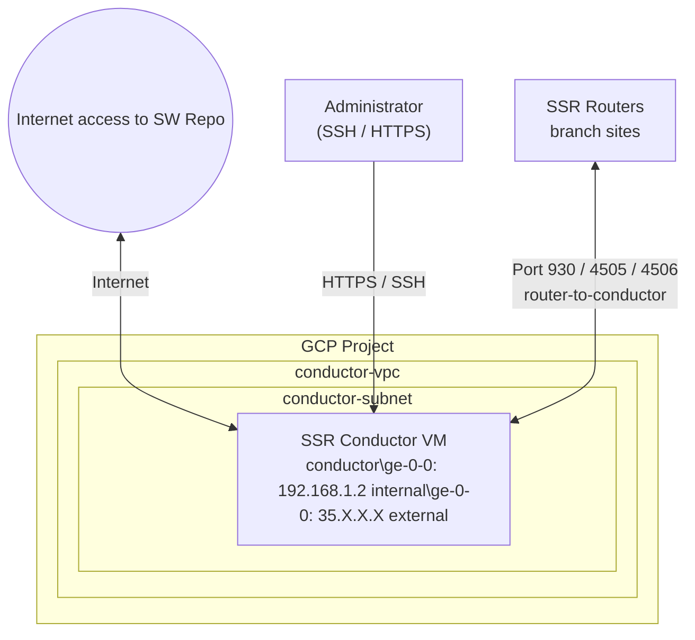

import InstanceSizing from './_byol_gcp_instance_types.md'


This guide walks you through deploying a **Session Smart Conductor on the Google Cloud Platform (GCP)** using the Bring Your Own License (BYOL) plan. When you complete the steps in this guide, the conductor will be running SSR software version 7.1.4, configured with an authority name and conductor address, and ready for SSR routers to onboard.

## Guide Topics

| Step | Topic | Description |
|------|-------|-------------|
| 1 | [Create the GCP VM](deploy_gcp_conductor_install.mdx) | Launch the conductor VM using the GCP GUI. |
| 2 | [Verify the Installation](deploy_gcp_conductor_verification.md) | Verify the installation is successful, and log in to the conductor for the first time. |
| 3 | [Configure the Conductor](deploy_gcp_conductor_config.md) | Set the authority name, conductor address, and assign the asset ID. |
| — | [Appendix — GCP Conductor Configuration](deploy_appendix_gcp_conductor.mdx) | Complete Terraform variable reference for the GCP conductor deployment. |

## Network Topology

The diagram below shows the logical network of the GCP conductor deployed in this guide.



## Roles

| Device | Type | Role |
|--------|------|------|
| `conductor` | GCP VM (Marketplace) | Standalone SSR Conductor — centralized management and provisioning |

## Prerequisites

Before beginning, ensure the following are available:

- **GCP subscription** — Access to a GCP project with permission to create VPC networks, subnets, VM instances, and service accounts.
- **A VPC network** - Network where the Conductor is deployed (`conductor-vpc` in this guide). This includes:
   - A subnet (`conductor-subnet`) reachable via SSH and HTTPS for administration.
   - The appropriate subnet region.
   - An IPv4 range for the subnet (for example, `10.0.1.0/24`)
- **Outbound HTTPS access** - Used to connect to the software repository
- **SSR license** - Your SSR License may be required to deploy the GCP VM.
- **SSR software access credentials** — Username and token for software downloads and provisioning.
- **SSH key pair** — An SSH key pair to authenticate to the conductor VM after deployment.

#### How to Create a VPC and Subnet

Use the following steps to create a VPC and subnet where the conductor VM will be deployed. 

During the GPC VM deployment, a single network interface (`nic0`) is automatically created for the conductor VM. `nic0` is assigned an internal IP address within the created subnet and an external IP address for management (SSH, access to web console, and SSR router onboarding).


1. In the GCP console, use the searchbar to search for **VPC networks**. 
2. Select the top result.
3. On the VPC networks panel, click **Create VPC Network**.


4. Enter the following values, or substitute the appropriate values for your deployment:

- VPC name:  `conductor-vpc`
- Subnet: `conductor-subnet` 
- Region: The appropriate subnet region - in this guide it is `east-us`
- IPV4 range: `10.0.1.0/24` or a value appropriate for your deployment.


5. Once these fields are entered, scroll to the bottom and click **Create**. The VPC will appear on the VPC networks page. 

#### How to Create an SSH Key Pair

An SSH key pair is required to authenticate to the conductor VM after deployment. The public key is provided to the Marketplace deployment form; the private key stays on your local machine.

The following example uses a macOS terminal.

1. Open a terminal on your local machine and run:

   ```
   ssh-keygen -t rsa -b 4096
   ```

2. When prompted, enter a name for the key pair and a passphrase. The key files are saved to your home directory.

3. Display the public key by running the following command, replacing `<your-key-pair-name>` with the filename you chose:

   ```
   cat <your-key-pair-name>.pub
   ```

4. Copy the key output for use later. You will paste this value into the **SSH Public Key** field during the Marketplace deployment.

:::note
An existing SSH key pair can be used instead of creating a new one. In that case, skip this section and use your existing public key during deployment.
:::

## Instance Size

<InstanceSizing/>

## Software Version Requirements

- This guide installs **SSR 7.1.4** on the conductor. 

- The router software version must be lower than or equal to the conductor software version.

- BYOL instances require the conductor to run SSR 6.3.0-R1 or newer. SSR 7.1.4 satisfies this requirement.


## Related Documentation

- [Installing a BYOL Conductor-managed Router in GCP](intro_installation_byol_gcp_conductor.mdx)
- [System Requirements](intro_system_reqs.md)
- [Conductor Deployment Best Practices](bcp_conductor_deployment.md)
- [Onboard an SSR Device to a Conductor](onboard_ssr_to_conductor.md)
