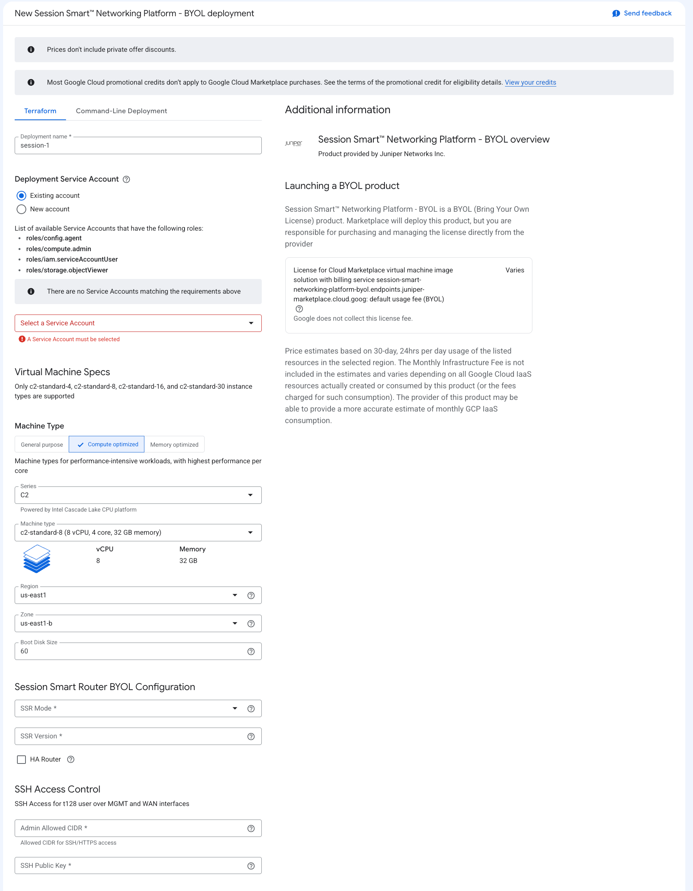

import NetworkDesign from './_deploy_gcp_conductor_network_design.md';

This step deploys the BYOL Session Smart Conductor VM from the GCP Marketplace. The deployment template creates the VM, reserves an external IP address on the control interface, and configures a network security group that includes VPC Firewall rules. SSR version 7.1.4 is installed and the node is initialized as a conductor.

## Requirements

The following infrastructure must exist in your GCP Deployment before deploying the conductor:

- A VPC network where the Conductor will be deployed (`conductor-vpc` in this guide). This includes:
   - A subnet (`conductor-subnet`) reachable via SSH and HTTPS for administration.
   - The appropriate subnet region.
   - An IPv4 range for the subnet (for example, `10.0.1.0/24`)

- An SSH key pair to authenticate to the conductor VM after deployment.

## Select the BYOL Plan

1. In the GCP console, search for **Marketplace** in the search bar. Click the Marketplace listing in the results.

2. Enter **Session Smart Networking Platform - BYOL** in the Marketplace search tool, and select the **Session Smart Networking Platform - BYOL** result.

3. On the product details page, click **Launch**.

## Deploy via Google Cloud Marketplace

Use the following table to complete the matching fields in the Deployment Template. 

   :::important
   Leave the Mist-managed and Conductor-managed router sections empty. Providing inputs for a conductor deployment will cause the deployment to fail.
   :::

<NetworkDesign/>

   :::caution
   `Admin Allowed CIDR` access must be restricted to known source addresses prior to deployment. 
   After the deployment completes and your environment is stable, update the associated NSG rules to restrict access for `Control Allowed CIDR` to known source addresses.
   :::

The first part is the common template. Enter the required info from the table above.

The second part of the template is Conductor specific. Enter the required info from the table above.

Once all of the conductor sections of the template are filled out with the required information, click **Deploy**.

A green checkmark appears under **Status** for each successfully created resource. 

   

After the VM is created, the the SSR software installation and initialization process runs automatically. Select the Details tab to find the public IP address of the new Conductor. This is necessary to log in to the Conductor GUI in Step 2. **Allow approximately 20 minutes for initialization to complete** before proceeding to [Step 2 — Verify the Installation](deploy_gcp_conductor_verification.md).

## Next Step

Proceed to [Step 2 — Verify the Installation](deploy_gcp_conductor_verification.md).
